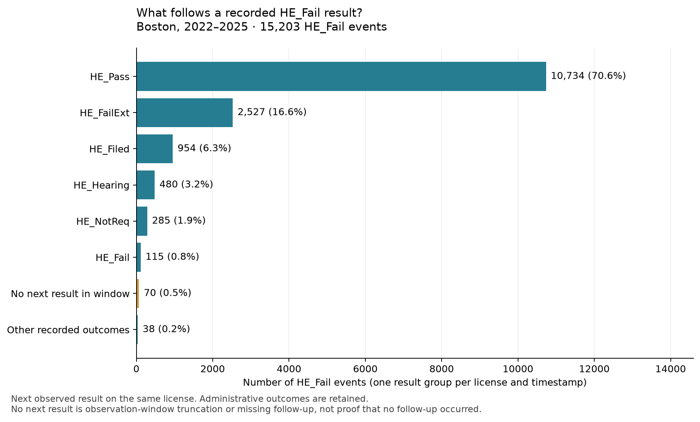

# Quality audit and process-mining findings

The two OCEL 2.0 logs are suitable for studying **recorded inspection-result
sequences, repeat-result intervals, and license/property/finding relationships**.
The detailed 2022–2025 view is a practical starting point for teaching; the full
history supports longer traces. These are overlapping views of one source.

They are not a complete visit or remediation lifecycle. A recorded pass does not
establish a repair date, and inspection data cannot establish food-poisoning
incidence. Current-state metadata is explicitly labelled as a snapshot.

Snapshot completed: `2026-11-02T07:15:53.742875Z`. Source:
[Analyze Boston food establishment inspections](https://data.boston.gov/dataset/food-establishment-inspections).
All numbers below come from the frozen snapshot, not a live query.

## Delivered artifacts

| View | Events | Objects | Licenses | Qualified E2O links | Qualified O2O links |
|---|---:|---:|---:|---:|---:|
| History (2006–2026) | 220,270 | 236,108 | 11,324 | 617,394 | 397,124 |
| Detailed (2022–2025) | 60,304 | 239,811 | 8,341 | 340,292 | 279,988 |

The detailed view includes 167,255 finding
objects. All IDs, attributes, timestamps, and relationships were checked against
the original rows; source row IDs accompany every event and finding.

## Source quality and modeling revisions

| Check | Finding and handling |
|---|---|
| Complete API retrieval | 907,385 rows across 29 pages; hashes, exact counts, ordered IDs, and stable metadata checked |
| Missing/invalid result dates | 6,398 rows excluded; no date imputation |
| Conflicting outcomes at one license/time | 88 rows in 20 groups quarantined |
| Explicit `DATAERR` result | 42 rows quarantined |
| Total exclusions | 6,528 rows (0.72%) |
| Accepted source rows | 900,857 rows → 220,270 result events |
| Exact duplicates | 0; deduplication would preserve all source row aliases |
| No usable property ID | 43,416 historical events retained without a property link |

Treating every accepted row as an inspection would inflate the event count by
**4.09×**. The extraction instead groups exact
license/result timestamps and links the individual findings to that result.
The public source has no inspection ID, so this grouping remains a transparent
reconstruction assumption rather than a source-verified case identifier.

The first mining run exposed lexical misordering of timestamps with fractional
seconds. The final exporter and analysis sort parsed UTC datetimes; a regression
test covers whole-second versus fractional-second records. A separate gzip test
caught embedded output filenames; the final exports rebuild to identical bytes
even in a different directory.

Of rows with usable result times, 1,124
have a status timestamp before the result, and
105,789 have a violation timestamp
after it. Those fields therefore remain snapshot attributes. We do not derive
repair events, license lifecycle events, or historical status changes from them.

## Repeat-result patterns in 2022–2025

Of 8,341 license traces, 5,578 have more
than one recorded event; the median trace has 5
events. There are 3,880 distinct activity sequences.
The historical view has 10,593 multi-event traces
and a median of 13 events per license.

There are **15,203 `HE_Fail` events** in the recent view:

- The next observed result is `HE_Pass` for **10,734
  (70.6%)** of them. Conditional on
  this successor, the median gap is **7.12 days**,
  with a 10th–90th percentile range of
  6.14–14.03 days.
- 10,588 of all 15,203 `HE_Fail` events
  (69.6%) have `HE_Pass` as their next
  result within 30 days. This uses all observed failures as the denominator,
  including those with another next outcome or no observed successor.
- 70 have no next result within this view. This can reflect
  the time window or missing observations; it does not prove no follow-up.

The median gap to any next recorded outcome is
7.11 days after `HE_Fail`
(15,133 observed pairs), versus
147.03 days after `HE_Pass`
(19,475 observed pairs).
This is consistent with different follow-up patterns, but does not identify
inspection purpose or prove a causal effect of failure. No reinspection ID or
remediation episode links the two results.

## Administrative batches and sensitivity

The largest simultaneous batch has **5,752 licenses** with
`HE_NotReq` at `2022-03-15T19:22:42.093000Z`. There are
289 subsecond consecutive
same-license pairs, all `HE_NotReq` → `HE_NotReq`. These patterns strongly suggest
administrative/batch recording; they should not be interpreted as physical visits
or zero-duration work. The source records remain intact rather than being merged
by an invented rounding rule.

As a sensitivity analysis, removing `HE_NotReq` removes
13,437 events, leaving 46,867 events across
5,039 licenses. 3,302 original
license traces contain only that code. The projected fail-to-next-pass count is
10,908, and its median interval is
7.12 days. This projection skips
administrative results; it is reported separately and does not alter the exports.

## Why object-centric analysis adds value

The recent log links 3,911 properties, of which
**1,310 (33.5%)**
have results for multiple licenses. A property-level trace can thus interleave
different establishments/licenses. Flattening solely by property would conflate
those license processes; OCEL preserves both perspectives and their shared site.
Property IDs are recorded source associations, not inferred ownership.

7,875 recent events
(13.1%) have no usable property link, so
site-based analyses cover a selected subset. There are
1,209 property/timestamp groups with
multiple events; their serialization order is not a causal order.

Findings supply codes, severity strings, descriptions, and recorded snapshot
statuses for inspecting result composition. Each finding is a single observation,
not a recurring violation episode. Source row IDs let students inspect the
evidence behind individual result/finding relationships.

## Verification evidence

- Full-source reconciliation passed for both exports, including eligibility,
  outcome/date conservation, row grouping, findings, license attributes, and
  property links: [validation.json](validation.json).
- Qualified graphs have unique IDs, valid references, declared and correctly
  typed attributes, valid timestamps, and no objects disconnected from events.
- PM4Py **2.7.23.11** imported both files with all IDs, E2O/O2O
  qualifiers, event timestamps, and numeric finding counts intact. Its license
  directly-follows graphs match the independent counts exactly:
  153 historical edges and
  88 recent edges.
- The upstream legacy schema's string-only attribute-value constraint was
  corrected to OCEL 2.0 scalar types, then actual values were checked against
  their declarations. This is explicitly recorded, not an unmodified-schema
  validation claim. See [schema provenance](../schemas/provenance.json).
- Independent full rebuilds produced identical compressed bytes for both logs
  and identical source-quality reports: [reproducibility.json](reproducibility.json).
- Every source row is either represented or quarantined, with no overlap or
  omissions: [row-accounting.json](row-accounting.json).
- Regression tests are in [tests](../tests); run `.venv/bin/pytest -q`.

All detailed statistics, directly-follows counts, and auditable example event
IDs are in [process-mining.json](process-mining.json). Quarantined row IDs are in
[source-issues.json.gz](source-issues.json.gz). For modeling assumptions,
snapshot semantics, observation-window truncation, and source limitations, see
[MODEL.md](../docs/MODEL.md).
